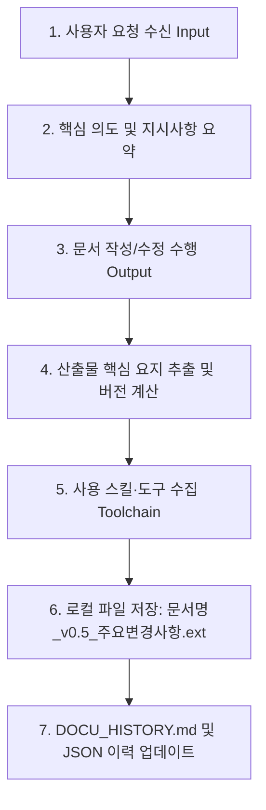

# Docu-Git — 문서 이력관리 에이전트 스킬 (Document Version Control Skill)

**Docu-Git**은 Git의 변경 이력 관리 메커니즘을 문서 작성 작업에 적용한 에이전트 스킬입니다.
사용자의 모든 문서 관련 요청(Input)과 에이전트의 산출물(Output)을 핵심 요지가 손실되지 않도록 고밀도로 요약하여 기록하고, 저장되는 파일명에 버전을 자동으로 부여 관리합니다.
또한 각 커밋에서 **어떤 스킬·도구로 작업했는지(Toolchain)** 를 함께 남겨, 다른 PC나 다른 세션에서 작업을 이어받을 때 동일한 방식으로 편집을 계속할 수 있게 합니다.

---

## 🎯 주요 특징 (Core Features)

1. **연속적 Input/Output 이력 기록**: 사용자의 대화 요청과 산출물 전체를 원문 훼손 없이 핵심만 축약하여 `DOCU_HISTORY.md`에 지속 기록.
2. **버전 명명 자동화**: 로컬 파일 저장 시 지정된 버전 규칙 자동 적용.
   - **파일명 표준**: `{문서 기본명}_v{버전}_{주요 변경 요약}.{확장자}`
   - **예시**: `행정정책_성과관리논문_v0.5_이론 단일화(젠의 역량접근법).md`
3. **고밀도 요약 (High-Density Summarization)**: 장문의 요청과 산출물에서 노이즈를 제거하고 핵심 논지 및 구조적 변화만 3~5줄로 압축 추출.
4. **Git 라이크 문서 관리 명령어 세트**: Status, Log, Diff, Branch(변형 문서), Tag, Rollback 이력 추적 지원.
5. **작업 환경(Toolchain) 기록**: 각 커밋에 사용한 스킬·도구와 그 출처를 함께 기록하여, 다른 PC에서 이력을 열었을 때 동일한 스킬로 작업을 이어갈 수 있도록 보장. 상세 규칙은 [`references/toolchain_tracking.md`](references/toolchain_tracking.md).

---

## 🚀 트리거 조건 (Trigger Keywords)

- **한국어**: `Docu-Git`, `문서 이력관리`, `문서 버전관리`, `문서 이력 기록`, `문서 커밋`, `문서 버전 저장`, `문서 히스토리`, `이력 남겨줘`, `버전 포함 저장`, `문서 버전 확인`, `작업 환경 기록`, `사용 스킬 기록`
- **English**: `docu-git`, `docugit`, `document version control`, `docu history`, `docu commit`, `docu log`, `docu diff`, `docu status`, `docu env`

---

## 🔄 표준 워크플로우 (Operational Workflow)

Docu-Git 스킬이 활성화되면 문서를 다루는 모든 입출력 프로세스는 다음 단계를 거칩니다.

### 1단계: Input 수신 및 요약 추출
- 사용자의 요청 문장에서 **작업 의도(Intent)**, **추가/수정/삭제 지시사항**을 포착합니다.
- 부가적인 대화성 수식어를 제외하고 고밀도 아웃라인 형태(3줄 이내)로 핵심만 압축합니다.

### 2단계: 문서 생성 또는 수정 수행
- 요청받은 문서 내용(논문, 보고서, 기획서, 고시문 등)을 완성도 높게 작성합니다.

### 3단계: 문서 버전 (Semantic Version) 계산
- `references/versioning_rules.md` 지침에 따라 버전을 결정합니다:
  - `v0.1`: 최초 구조/개요 수립 및 초안
  - `v0.2~v0.4`: 내용 보완 및 일반적인 수정
  - `v0.5`: 이론적 뼈대 단일화, 주요 섹션 결합 등 주요 업데이트 (Major Milestone)
  - `v1.0`: 최종 완성본 및 확정 제출본

### 4단계: 사용 스킬·도구 수집 (Toolchain Capture)
- 이번 작업에서 **실제로 사용한** 스킬·도구를 수집합니다. 설치되어 있으나 쓰지 않은 것은 기록하지 않습니다.
- 스킬은 `{스킬명}@{버전}` 형식, 직접 작성한 스크립트·라이브러리 조합은 도구 항목으로 기록합니다.
- 수집 대상과 판단 기준은 `references/toolchain_tracking.md`를 따릅니다.

### 5단계: 버전 포함 로컬 파일 저장
- 로컬 파일로 저장 시 파일 명명 규칙을 반드시 준수합니다:
  - `{문서명}_v{버전}_{주요변경사항}.{ext}`
  - 예시: `성과관리논문_v0.5_이론 단일화(젠의 역량접근법).md`

### 6단계: Commit Log 업데이트 (`DOCU_HISTORY.md`)
- `references/commit_log_template.md` 템플릿에 따라 프로젝트의 `DOCU_HISTORY.md`에 새 커밋 블록을 추가합니다.
- 커밋 블록의 **`사용 스킬 / 도구`** 필드와 매니페스트의 `toolchain`·`skills_used`를 함께 갱신합니다.

---

## 🧰 작업 환경 기록 (Toolchain Tracking)

문서는 **무엇을 고쳤는가**뿐 아니라 **무엇으로 고쳤는가**에 따라 이어받는 방식이 달라집니다.
예를 들어 HWP 문서를 XML 파싱 방식으로 편집해 왔다면 다른 PC에서도 같은 스킬을 써야 서식이 유지되고, 조판 작업이 섞여 있었다면 한글 프로그램이 설치된 환경이 필요합니다.
따라서 Docu-Git은 각 커밋에 다음을 기록합니다.

| 기록 항목 | 설명 | 예시 |
| :--- | :--- | :--- |
| `name` | 스킬 또는 도구 이름 | `hwp-edit`, `docu-git`, `python+hwp-com` |
| `version` | 스킬 메타데이터의 버전 | `1.0.0` |
| `source` | 설치 출처(URL·경로). 다른 PC에서 동일 설치에 필요 | `https://github.com/{owner}/skills/tree/main/hwp-edit` |
| `scope` | 이 작업에서 담당한 범위 | `표·본문 텍스트 편집`, `자간·그림 등 조판` |
| `requires` | 외부 의존 요건(있을 때만) | `한글(Hancom Office) 설치 필요` |

### 기록 위치
1. **`DOCU_HISTORY.md` 헤더** — `## 🧰 작업 환경 (Toolchain)` 표에 프로젝트 전체에서 사용된 스킬·도구를 누적 기록
2. **각 커밋 블록** — `- **사용 스킬 / 도구**: {name}@{version} ({scope})` 한 줄
3. **`DOCU_HISTORY.json`** — 최상위 `toolchain` 배열(상세 정보)과 각 `history[]` 항목의 `skills_used` 배열(해당 커밋에서 쓴 것)

### 다른 PC에서 이어받을 때
1. 이력 파일의 `toolchain`을 먼저 읽고, 현재 환경에 없는 스킬을 `source`에서 설치합니다.
2. 설치할 수 없는 항목(예: 한글 미설치)은 **해당 범위의 작업을 보류**하고 사용자에게 알립니다. 다른 방식으로 대체 편집하면 서식이 깨질 수 있습니다.
3. 직전 커밋의 `skills_used`와 다른 방식으로 작업해야 한다면, 그 사유를 새 커밋의 `Diff Snapshot`에 남깁니다.

---

## 🛠️ Docu-Git 전용 관리 기능 (Git-like Commands)

에이전트는 사용자가 다음과 같은 문서 관리 명령을 내릴 때 해당 처리를 수행합니다.

| 명령어 / 요청 | 설명 및 동작 |
| :--- | :--- |
| **`docu-git status`** | 현재 관리 중인 문서 목록, 최신 버전(`vX.Y`), 활성 브랜치 및 최근 커밋 타임스탬프 표시 |
| **`docu-git log`** | 지금까지 기록된 사용자 요청(Input)과 산출물(Output)의 핵심 이력 타임라인 조회 |
| **`docu-git diff <v1> <v2>`** | 두 버전 간의 주요 구조적 변화, 추가/삭제된 핵심 개념 및 논지 차이점 비교 |
| **`docu-git branch <이름>`** | 원본 문서 기반의 변형 버전(예: `요약보고서`, `발표자료용`, `영문판`) 분기 관리 |
| **`docu-git tag <태그명>`** | `final-draft`, `submitted`, `reviewed` 등 이정표 태그 부여 |
| **`docu-git rollback <vX.Y>`** | 이전 버전의 문서 내용과 요약 스냅샷을 확인하고 해당 시점 기준으로 복원 또는 재작성 |
| **`docu-git env`** | 이력에 기록된 작업 환경(스킬·도구, 버전, 출처, 담당 범위) 목록 표시 |
| **`docu-git env --check`** | 기록된 스킬·도구 중 현재 PC에 **없는 항목**과 설치 출처를 보고. 설치 불가 항목은 영향 받는 작업 범위를 함께 안내 |

---

## 📁 참조 및 템플릿 문서 (References & Templates)

상세 규칙 및 서식은 다음 하위 참조 파일을 준수합니다. (경로는 스킬 폴더 기준 상대 경로이며, PC가 바뀌어도 그대로 유효합니다)
- **버전 규칙 & 요약 지침**: [`references/versioning_rules.md`](references/versioning_rules.md)
- **커밋 로그 템플릿**: [`references/commit_log_template.md`](references/commit_log_template.md)
- **작업 환경 기록 규칙**: [`references/toolchain_tracking.md`](references/toolchain_tracking.md)
- **이력 매니페스트 JSON**: [`templates/docu_history_manifest.json`](templates/docu_history_manifest.json)
